# LitePilot

A tiny Windows popup for AI chat. Press a shortcut, ask, press Esc.

_Version 0.1.21._

<p>
  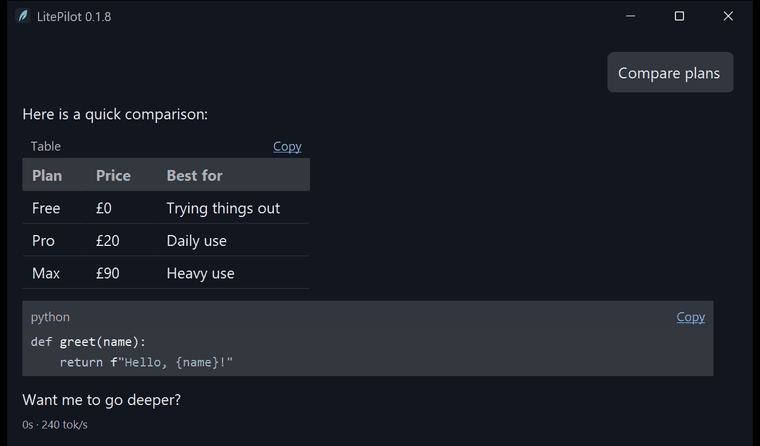
  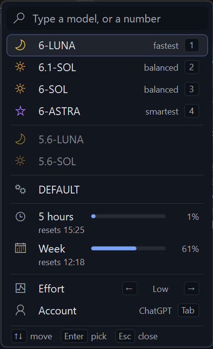
  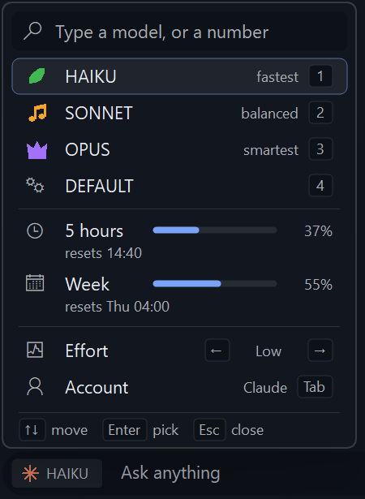
  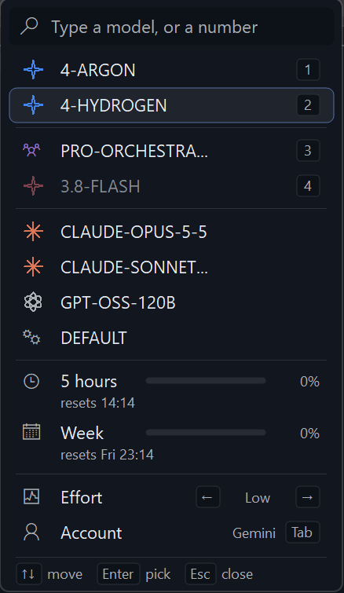
</p>

## What it does

- **Instant:** one shortcut opens it over whatever you are doing, Esc hides it. Everything is keyboard-first.
- **Your accounts:** sign in with ChatGPT or Claude, or add any OpenAI-compatible or Anthropic API key. Switch account, model and effort with Ctrl+M, which also shows how much of your plan's 5-hour and weekly limits you have used.
- **Remembers you:** say "remember that ..." and it keeps the fact for every future chat. See [Memory](#memory).
- **Pictures and files:** paste, drop or attach (Ctrl+Shift+A) pictures, PDFs and text files. They show as small tiles in the typing box with an x to remove them, and as a thumbnail in the chat.
- **Good-looking replies:** tables, code with Copy buttons, links, lists, right-to-left text and embedded images. Under each reply: time, speed and total tokens (`6s · 154 tok/s · 1,842 tokens`).
- **Knows your PC:** with a Claude or ChatGPT sign-in it can look things up on this computer, read-only. See [PC diagnostics](#pc-diagnostics).
- **Light on the PC:** about 1.2 MB on disk and about 9 to 14 MB of RAM with the window open. See [Performance](#performance).

## Install

- **Setup:** run `LitePilot-<version>-Setup.exe` (per-user, no admin rights). LitePilot checks for a newer release once a day. When one is available it asks: Update now (downloads, verifies and restarts once no reply is being written), Later, or Never show again. Settings > Startup has a switch to turn checks off.
- **Portable:** unzip `LitePilot-<version>-Portable.zip` and run `LitePilot.exe`. Settings and chats stay beside it; API keys stay in Windows Credential Manager on that PC. Portable copies update from the same release feed.
- **API key:** Settings > pick a preset > Add profile > enter model and key > Save.
- **Claude or ChatGPT login:** Settings > pick the profile > Sign in. The official CLI downloads on first sign-in, after you confirm.

| Keys | Action |
|---|---|
| Alt+Space (configurable) | Open or hide |
| Enter / Shift+Enter | Send / new line |
| Esc | Stop a reply, otherwise hide |
| Tab | Move between typing and the chat |
| Page Up / Page Down, Ctrl+Up / Ctrl+Down | Scroll the chat |
| Ctrl+H | Previous chats (type to search, arrows, Enter, Del) |
| Ctrl+N | New chat |
| Ctrl+[ and Ctrl+] | Older or newer chat |
| Ctrl+K | Next account |
| Ctrl+M | Account, model, and effort menu |
| Ctrl+T | Keep on top |
| Ctrl+Shift+C | Copy the last code block or table |
| Ctrl+, | Settings (Tab or arrows, Enter, Esc, 1 to 5 on the first page) |
| F1 | List of shortcuts |
| Right-click (typing box or chat) | Undo, cut, copy, paste, delete, select all; selects the word under the pointer |

Replies show text, tables, code, links, and embedded PNG, JPEG, and GIF images. Web images appear as links.

The Copilot-key shortcut is on by default and registers Win+Shift+F23. Turn off **Open with the Copilot key** in Settings > Shortcut and startup to opt out. If Windows or another app owns it, normal registration fails. On Windows 11, check Settings > Personalization > Text input > Customize Copilot key on keyboard and try Search or Custom; choices vary, and this does not guarantee that Windows releases the shortcut.

The **global hook fallback** is also on by default and can be turned off separately in Settings. If both Copilot options are enabled and normal registration fails, LitePilot installs a system-wide low-level keyboard hook to intercept that shortcut; it passes other keys through. Security software may flag global hooks, and Windows or keyboard implementations may still prevent this from working. Existing explicit settings are preserved.

## Memory

<p>
  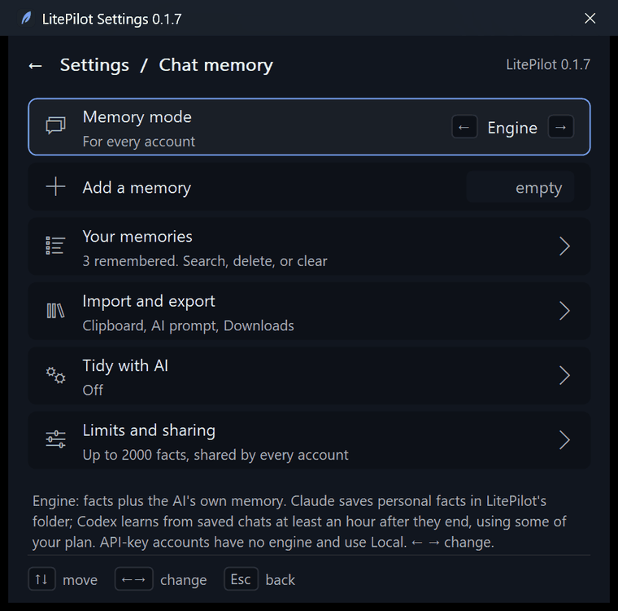
  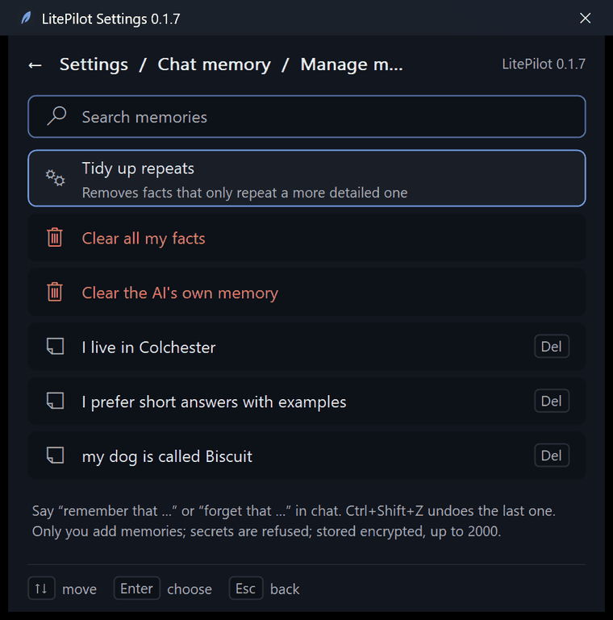
</p>

LitePilot keeps a short list of facts about you and uses them in every chat, on every account.

- **Add and remove in chat:** "remember that I live in Colchester", "forget that ...". Ctrl+Shift+Z undoes the last change. Only you add memories, never the AI, and anything that looks like a password or key is refused.
- **Stored safely:** the list is encrypted with Windows' own protection and lives in LitePilot's folder. Up to 2000 facts (changeable).
- **Memory mode** (Settings > Chat memory), the same for every account:
  - **Engine** (ChatGPT and Claude sign-in): facts plus the AI's own memory. Claude saves personal facts in LitePilot's folder. Codex learns from saved chats at least an hour after they end, using a little of your plan.
  - **Local:** only your facts are sent with each chat. When the list is long, only the facts related to the question are sent. This is the mode for API keys.
  - **Off:** nothing is remembered or sent.
- **Your memories:** search, delete one, clear all, or **Tidy up repeats** to remove facts that only repeat a more detailed one. **Tidy with AI** (off by default) can also merge repeats, after you review them.
- **Move them:** import facts from the clipboard, copy a ready-made prompt that asks another AI what it knows about you, or save a plain text file to Downloads. **Back up and move** exports settings, facts and Claude's own memory in one passphrase-encrypted file that opens on any PC. API keys and sign-ins are not included.
- **Limits and sharing:** one shared list for every account, or a list per account.

## PC diagnostics

Ask things like "is the US keyboard installed?", "why is my PC slow?" or "what's using port 8080?" and the AI checks this computer itself (Claude and ChatGPT sign-in accounts).

| Tool | Looks at |
|---|---|
| `sys` | Windows version, hardware, updates, pending reboot, activation, power plan, battery, displays, audio, printers |
| `lang` | languages and keyboard layouts, locale, time zone, input method |
| `disk` | drives, disk health, folder size, temp folders, largest files |
| `proc` | top processes, process details, CPU/RAM/disk load, startup items, services, which process owns a port |
| `net` | adapters, IP setup, ping, TCP connect test, DNS, listening ports, Wi-Fi, proxy, hosts file, firewall, routes |
| `events` | recent errors, app crashes and hangs, blue screens, reliability, failed updates |
| `sec` | Defender, UAC and Secure Boot, BitLocker, local users, administrators |
| `apps` | installed programs, devices with problems, default apps, environment variables |
| `file` | read a text file, list a folder, file info (Documents, Downloads, Desktop) |
| `reg` | a few registry keys (installed programs, Run keys, Windows version, time zone, regional settings) |
| `dev` | developer tool versions; git status, log and diff of a repo folder |

- **Zero cost for normal chat:** a quick local check of your message decides which tools (if any) it needs. Ordinary chat sends no tools at all; a PC question sends only the one or two that fit.
- **`/diag`:** start a message with `/diag` to give the AI every tool for that message, if the check missed what you meant.
- **Safety:** read-only. Every choice runs one fixed query built into LitePilot; the AI can't run its own commands or scripts and only supplies checked values (a host name, a port, a path). No admin rights are ever requested ("requires elevation" comes back instead). Each query stops after 10 seconds. File access is limited to Documents, Downloads and Desktop, and never keys, passwords, browser or password-manager data. Passwords, tokens and keys are blanked out of every result, results are capped at 4 KB, and the AI is told that tool output is data, not instructions. Every call (never its output) is noted in `diag-audit.log` in LitePilot's data folder.

## Menus and settings

<p>
  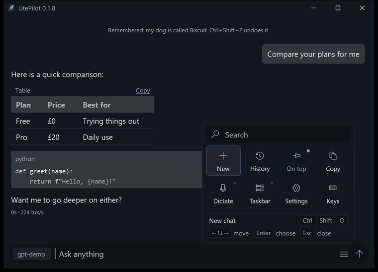
  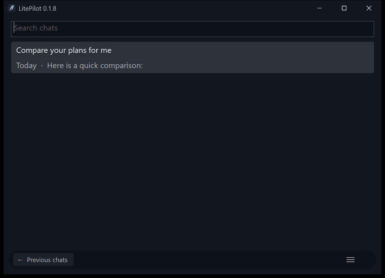
</p>

The menu button opens quick actions (new chat, history, keep on top, copy, dictate, taskbar, settings, shortcuts). Ctrl+H lists previous chats with search.

<p>
  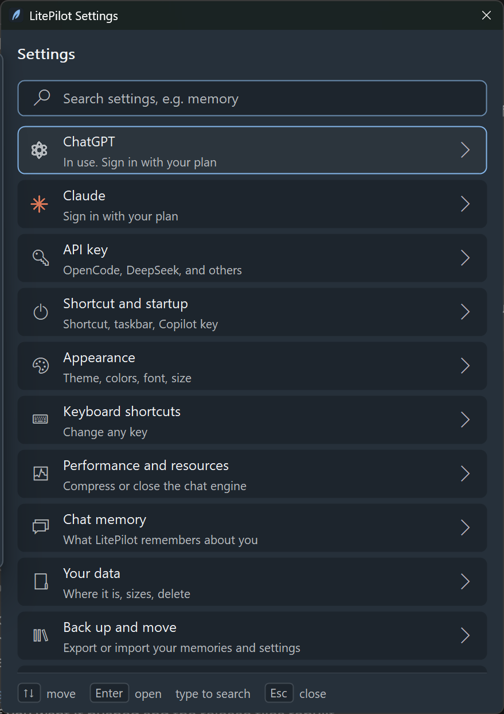
  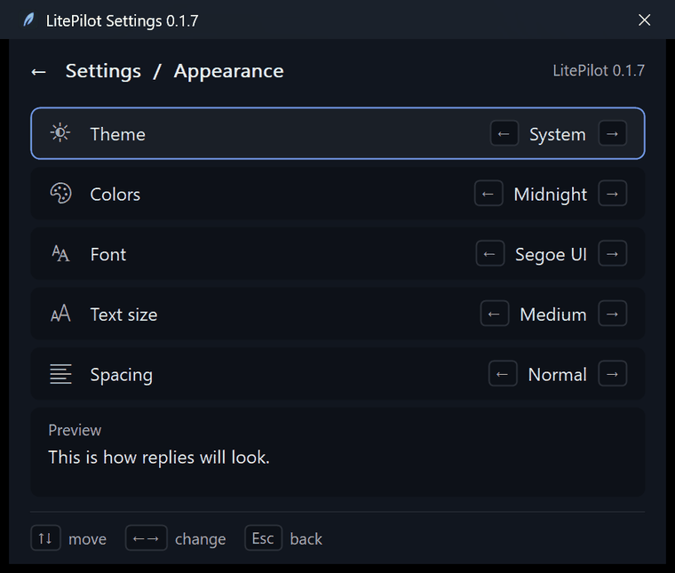
  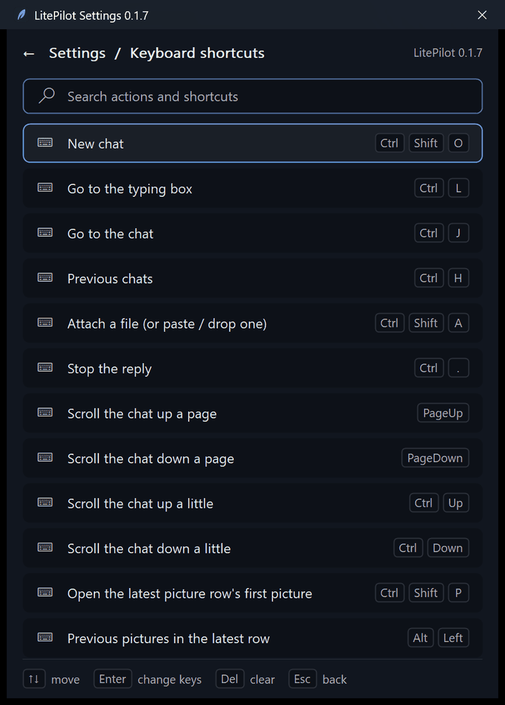
</p>

Settings cover accounts and API keys, the shortcut and startup options, appearance (theme, colors, font, size, spacing), every keyboard shortcut, performance, memory, your data and backups. Dictation (Windows voice typing) is off until you turn it on.

## Build

The release build requires Rust and MSVC build tools. The version comes from `version` in Cargo.toml, the one master version for the app, the file properties and the release file names.

```
build-release.cmd    # writes dist\LitePilot-<version>-Setup.exe and dist\LitePilot-<version>-Portable.zip
python tools/e2e.py <empty-temp-folder> [--cli]
```

`src/core` is platform-neutral; a future macOS or Linux front end adds a sibling of `src/windows`.

## Performance

About 1.2 MB on disk, about 0.3 MB of RAM hidden in the tray, and about 9 to 14 MB with the window open. The
AI engine for sign-in accounts runs separately and is squeezed when idle. Measured numbers, settings, and how it is
built are in [docs/PERFORMANCE.md](docs/PERFORMANCE.md).
